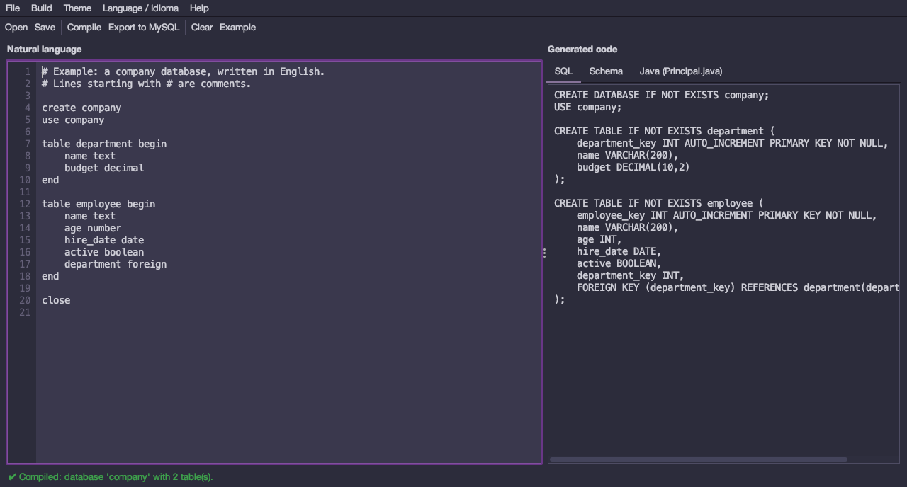
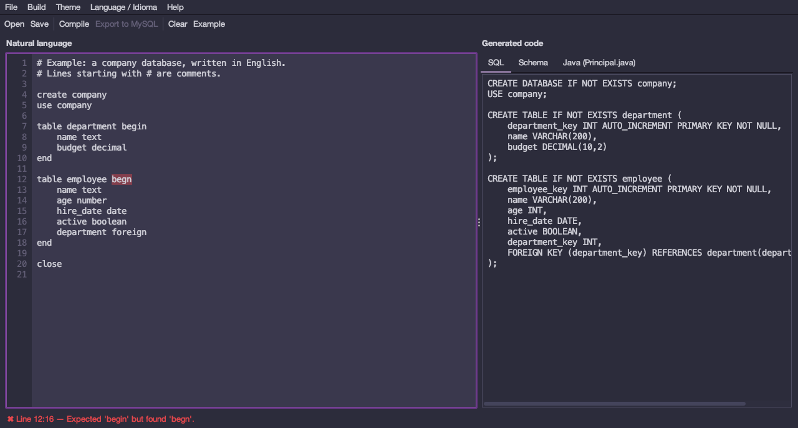
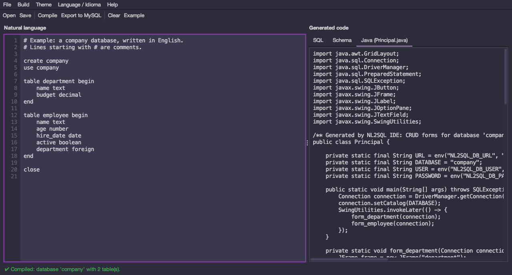
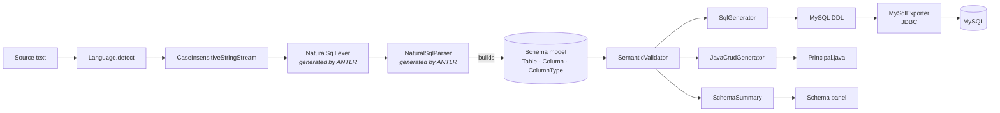

# NL2SQL IDE: Natural Language → SQL & Java Compiler

[](https://github.com/leon004/InteliJ-internal-IDE-with-ANTLR-to-generate-SQL-from-Natural-Language/actions/workflows/ci.yml)


A desktop mini-IDE that **compiles a bilingual (English / Spanish) natural-language DSL into MySQL DDL and a working Java CRUD application**.
You describe a database in plain words, in English, Spanish, or a mix of both. The compiler checks it as you type, shows the generated SQL, and can create the database on a live MySQL server in one click.



```text
create company                     CREATE DATABASE IF NOT EXISTS company;
use company                        USE company;
table employee begin         →     CREATE TABLE IF NOT EXISTS employee (
    name text                          employee_key INT AUTO_INCREMENT PRIMARY KEY NOT NULL,
    salary decimal                     name VARCHAR(200),
    department foreign                 salary DECIMAL(10,2),
end                                    department_key INT,
close                                  FOREIGN KEY (department_key) REFERENCES department(department_key)
                                   );
```

The same program in Spanish is `crear` / `usar` / `tabla … inicio` / `nombre letras` / `fin` / `cerrar`, and the two can be mixed freely.

---

## Table of contents

- [Highlights](#highlights)
- [Quick start](#quick-start)
- [The language](#the-language)
- [How it works](#how-it-works)
- [Project structure](#project-structure)
- [Development guide](#development-guide)
- [Configuration](#configuration)
- [Testing](#testing)
- [Roadmap](#roadmap)
- [Author](#author)
- [Resumen en español](#resumen-en-español)

## Highlights

- **Bilingual language.** Every keyword has an English and a Spanish spelling, and both are accepted in the same program with no switch to flip. The compiler detects the program's main language and reports errors, the schema summary and the generated app's labels in that language.
- **Real compiler pipeline.** An ANTLR 3 grammar ([`NaturalSql.g`](src/main/antlr3/io/github/leon004/nl2sql/compiler/NaturalSql.g)) generates the lexer and parser at build time. The parser builds a typed schema model, a semantic analysis pass validates it, and separate back ends emit code.
- **Two code generators.** One emits idempotent **MySQL DDL** with primary and foreign keys. The other emits a complete **Java Swing + JDBC CRUD application** (one form per table, prepared statements). A test compiles the generated Java to make sure it builds.
- **IDE experience.** Live validation as you type, error highlighting with line and column, readable error messages ("Expected 'begin' but found 'begn'" / "Se esperaba 'inicio' pero se encontró 'inico'"), line numbers, keyboard shortcuts, five FlatLaf themes, and an English / Spanish interface (menu **Language / Idioma**, remembered between runs).
- **Semantic checks** that a grammar can't express: duplicate tables and columns, and foreign keys that point to undeclared or later-declared tables. Errors are caught before MySQL sees them.
- **One-click export** to a MySQL server. The export runs on a background thread, and connection settings come from environment variables (no hard-coded credentials).
- **Engineering hygiene.** Maven build, runnable fat jar, a JUnit 5 suite, and a GitHub Actions pipeline that runs the generated SQL against a real MySQL 8.4 container.

| Live error highlighting | Generated Java CRUD app |
|---|---|
|  |  |

## Quick start

**Prerequisites:** JDK 17+ and Maven 3.9+. MySQL 8 is optional; you only need it for **Export to MySQL**.

```bash
git clone https://github.com/leon004/InteliJ-internal-IDE-with-ANTLR-to-generate-SQL-from-Natural-Language.git nl2sql-ide
cd nl2sql-ide
```

```bash
mvn package
```

```bash
java -jar target/nl2sql-ide-2.0.0-all.jar
```

The IDE opens in English with the English example ([`examples/company.txt`](examples/company.txt)) loaded. Press **Compile** (or <kbd>Ctrl</kbd>+<kbd>Enter</kbd>) to see the SQL, a schema summary and the generated `Principal.java`. **File → Load Spanish example** loads the same database written in Spanish, and **Language / Idioma → Español** switches the interface to Spanish.

<details>
<summary>macOS with Homebrew: installing the prerequisites</summary>

```bash
brew install openjdk@17 maven mysql
```

```bash
export JAVA_HOME="$(brew --prefix openjdk@17)"
```
</details>

## The language

A program creates one database, selects it, declares any number of tables, and ends with `close` / `cerrar`.
Keywords are case-insensitive, and `#` starts a comment.

| English | Español | Meaning | Generated MySQL |
|---|---|---|---|
| `create <db>` | `crear <db>` | create a database | `CREATE DATABASE IF NOT EXISTS <db>;` |
| `use <db>` | `usar <db>` | select it | `USE <db>;` |
| `table <t> begin … end` | `tabla <t> inicio … fin` | declare a table | `CREATE TABLE IF NOT EXISTS <t> (<t>_key INT AUTO_INCREMENT PRIMARY KEY NOT NULL, …);` |
| `close` | `cerrar` | end of program | (nothing) |

Column declarations go inside the table block as `<name> <type>`:

| English | Español | MySQL type |
|---|---|---|
| `number` | `numeros` | `INT` |
| `text` | `letras` | `VARCHAR(200)` |
| `decimal` | `decimal` | `DECIMAL(10,2)` |
| `date` | `fecha` | `DATE` |
| `boolean` | `condicion` | `BOOLEAN` |
| `foreign` | `foranea` | `<name>_key INT` + `FOREIGN KEY (<name>_key) REFERENCES <name>(<name>_key)` |

With `foreign` / `foranea`, the column name is the referenced table, and that table must be declared earlier in the program.

**Mixing languages.** There is no language switch: both sets of keywords are always active, so `crear shop use shop table client inicio name text fin close` is a valid program. The compiler counts the language-specific keywords (ignoring comments and words like `decimal` that are the same in both languages) and uses the majority language for messages and generated text. On a tie, the first keyword's language wins. Because both sets are reserved, a column can't be named exactly `date`, `text` or `end`. Names like `hire_date` or `ended` are fine.

Complete programs are in [`examples/`](examples): [`company.txt`](examples/company.txt) (English), [`empresa.txt`](examples/empresa.txt) and [`escuela.txt`](examples/escuela.txt) (Spanish), and [`mixed.txt`](examples/mixed.txt) (both). The full reference is also in the app under **Help → Language reference**.

## How it works



1. **Language detection.** [`Language.detect`](src/main/java/io/github/leon004/nl2sql/model/Language.java) picks the program's main language. It affects only messages and generated text, never what is accepted.
2. **Lexing.** A case-insensitive character stream feeds the ANTLR lexer, where each keyword rule accepts both spellings (`TABLA : 'tabla' | 'table';`). Identifiers keep their original spelling. Whitespace and `#` comments go to the hidden channel.
3. **Parsing.** The grammar's actions build immutable Java `record`s (`Schema`, `Table`, `Column`) with source spans. The parser and lexer fail fast on the first error, and [`SyntaxErrors`](src/main/java/io/github/leon004/nl2sql/compiler/SyntaxErrors.java) translates ANTLR exceptions into localized messages with exact character offsets.
4. **Semantic analysis.** [`SemanticValidator`](src/main/java/io/github/leon004/nl2sql/compiler/SemanticValidator.java) enforces unique names and foreign-key ordering, so the SQL is valid for MySQL.
5. **Code generation.** Back ends are plain classes that take a `Schema` and know nothing about the parser or the UI. You can add a new target (PostgreSQL, JPA entities, …) without touching the grammar.
6. **UI.** [`MainWindow`](src/main/java/io/github/leon004/nl2sql/ui/MainWindow.java) re-parses 300 ms after you stop typing, highlights the error span, and runs the MySQL export in a `SwingWorker` so the UI never freezes. Its own labels follow the interface language you pick, while compiler messages follow the program's language.

## Project structure

```text
├── pom.xml                                  Maven build (ANTLR codegen, tests, fat jar)
├── examples/                                Sample programs (all compiled by ExamplesTest)
├── docs/images/                             Screenshots
├── .github/workflows/ci.yml                 Build + tests + MySQL integration test
└── src
    ├── main
    │   ├── antlr3/io/github/leon004/nl2sql/compiler/
    │   │   └── NaturalSql.g                 ★ The grammar: single source of truth for the language
    │   ├── java/io/github/leon004/nl2sql/
    │   │   ├── Main.java                    Entry point (theme + window)
    │   │   ├── model/                       Schema, Table, Column, ColumnType, Keyword, Language, SourceSpan
    │   │   ├── compiler/                    NaturalLanguageCompiler (facade), error reporting, semantic checks
    │   │   ├── codegen/                     SqlGenerator, JavaCrudGenerator, SchemaSummary
    │   │   ├── db/                          DatabaseConfig, MySqlExporter
    │   │   └── ui/                          MainWindow, LineNumberGutter
    │   └── resources/…/                     ejemplo.txt / example.txt, loaded from the IDE
    └── test/java/…                          JUnit 5 tests (+ MySqlExporterIT)
```

`target/generated-sources/antlr3/` holds the generated `NaturalSqlLexer`/`NaturalSqlParser`. They are build output, so never edit them; change the grammar instead.

## Development guide

**Open in an IDE.** IntelliJ IDEA, Eclipse, VS Code and NetBeans all import `pom.xml` directly. Run `mvn generate-sources` once (or any build) so the IDE sees the generated parser. In IntelliJ, also mark `target/generated-sources/antlr3` as a generated source root if it isn't picked up automatically.

**Common tasks**

| Task | Command |
|---|---|
| Build and run unit tests | `mvn test` |
| Everything, including integration tests | `mvn verify` |
| Run the app from sources | `mvn compile exec:java` |
| Build the runnable jar | `mvn package` → `target/nl2sql-ide-<version>-all.jar` |

**Adding a new column type** (for example `hora` / `time` → `TIME`):

1. Add a token with both spellings (`HORA : 'hora' | 'time';`) and an alternative to the `tipo` rule in `NaturalSql.g`.
2. Add the constant to `ColumnType` with its Spanish keyword, English keyword and SQL type. Language detection picks it up automatically.
3. Add test cases in `NaturalLanguageCompilerTest` / `BilingualTest` / `SqlGeneratorTest`, then run `mvn test`.

**Adding a language:** add a constant to `Language`, a spelling to each `Keyword` and `ColumnType`, an alternative to each keyword rule in the grammar, and a translation wherever `language.pick(...)` is used.

**Adding a new code generator:** create a class in `codegen/` that takes a `Schema` and returns a `String`, add a tab for it in `MainWindow#buildWorkspace`, and give it a unit test.

## Configuration

**Export to MySQL** and the generated `Principal.java` read their connection settings from environment variables. You can also pass them as `-D` system properties, which take precedence.

| Environment variable | System property | Default |
|---|---|---|
| `NL2SQL_DB_URL` | `nl2sql.db.url` | `jdbc:mysql://localhost:3306/` |
| `NL2SQL_DB_USER` | `nl2sql.db.user` | `root` |
| `NL2SQL_DB_PASSWORD` | `nl2sql.db.password` | *(empty)* |

```bash
NL2SQL_DB_USER=root NL2SQL_DB_PASSWORD=secret java -jar target/nl2sql-ide-2.0.0-all.jar
```

## Testing

- **Unit tests** (`mvn test`) cover the grammar (valid programs, keyword and identifier edge cases, case-insensitivity, comments), English, Spanish and mixed programs, language detection, localized messages, error messages and highlight positions, the semantic rules, exact SQL output, and every program in `examples/`. The Java generator test **compiles the generated `Principal.java` with `javax.tools`** to prove that it builds.
- **The integration test** (`MySqlExporterIT`, run by `mvn verify`) exports a schema to MySQL twice to check idempotency, inspects the created tables through JDBC metadata, and inserts rows across a foreign key. It skips itself when `NL2SQL_DB_URL` isn't set. In CI it runs against a `mysql:8.4` service container.

## Roadmap

- [ ] Syntax highlighting and autocomplete for DSL keywords
- [ ] Column constraints (`obligatorio` → `NOT NULL`, `unico` → `UNIQUE`)
- [ ] More SQL dialects (PostgreSQL, SQLite) as additional generators
- [ ] Generate JPA entities / Spring Data repositories
- [ ] Migrate the grammar to ANTLR 4 with a visitor-based back end

## Author

**Leonardo Calderón Sastre** ([@leon004](https://github.com/leon004))

This project started as a compiler-design course project and was later modernized: Maven build, grammar-driven code generation, bilingual keywords, semantic analysis, a test suite and CI.

## Resumen en español

**NL2SQL IDE** es un mini-IDE de escritorio que compila un lenguaje natural en español o inglés (`crear`/`create`, `usar`/`use`, `tabla … inicio … fin`/`table … begin … end`, `cerrar`/`close`) a **SQL para MySQL** y a una **aplicación Java CRUD**. Puedes mezclar ambos idiomas, y los errores se muestran en el idioma principal del programa. Está construido con una gramática **ANTLR 3**, valida el programa mientras escribes, marca los errores en rojo con línea y columna, y puede crear la base de datos directamente en MySQL.

Para ejecutarlo: `mvn package` y luego `java -jar target/nl2sql-ide-2.0.0-all.jar`. La interfaz abre en inglés; cámbiala con **Language / Idioma → Español**, y carga el ejemplo en español con **Archivo → Cargar ejemplo en español**. La referencia completa del lenguaje está en **Ayuda → Referencia del lenguaje**.
